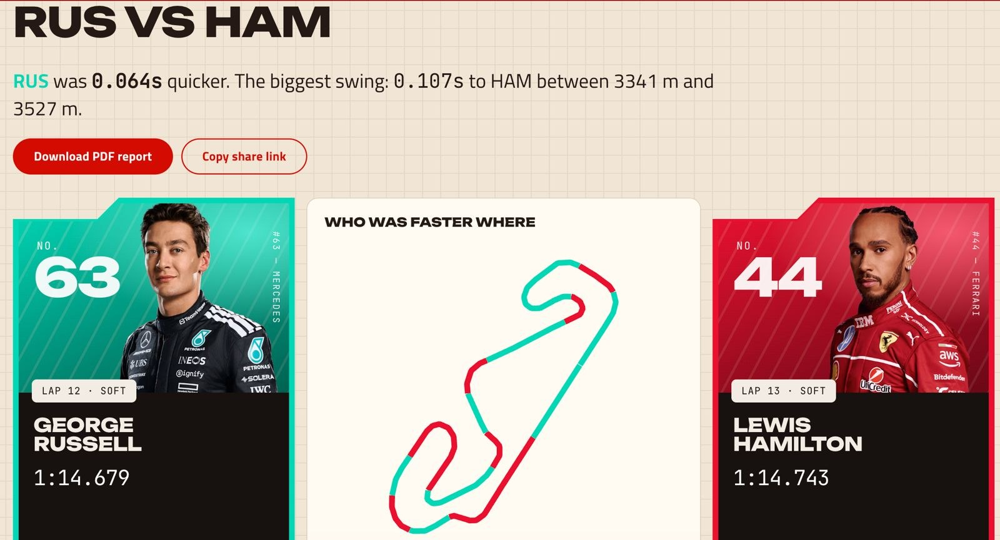
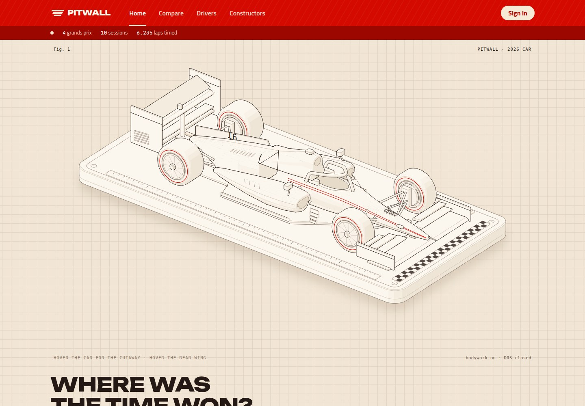
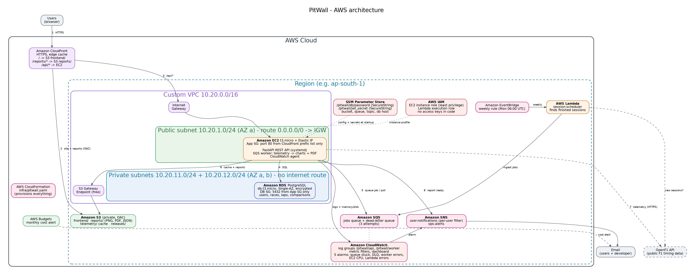

# PitWall: F1 Lap Telemetry Analyzer on AWS

PitWall is a website for comparing any two Formula 1 drivers' laps using real timing data. You pick a session (for example 2024 Italian GP qualifying) and two drivers, and PitWall overlays their laps:

- speed, throttle, brake and gear traces
- a running time gap across the lap
- a track map coloured by who was faster in each of 25 mini-sectors
- sector times and a short written verdict

Each comparison also produces a PDF report you can download or share.

Telemetry analysis is too heavy to run inside a web request, so it runs as a background job. The API queues the work on **SQS**. A worker on **EC2** processes the lap data, writes the charts and PDF to **S3**, and emails the user through **SNS**. **CloudFront** serves the site and the reports. A weekly **Lambda** picks up new race weekends automatically.

 

> **Status:** deployed on AWS (ap-south-1) in October 2026, then torn down to control cost. `./scripts/deploy.sh` recreates the whole stack in about 15 minutes, and `./scripts/local-up.sh` runs the full pipeline on a laptop with no AWS account (see [Run it locally](#run-it-locally)).



## Cloud services and why each one is there

| Area | Service | What it does in PitWall |
|---|---|---|
| Compute | **Amazon EC2** (t3.micro) | Runs the FastAPI backend and the SQS worker as systemd services. The worker is long-running, needs about 300 MB, and renders charts and PDFs, so it belongs on a server rather than in serverless functions. |
| Networking | **Amazon VPC** | Custom VPC with: a public subnet for EC2 (route to an Internet Gateway); two private subnets in two AZs for RDS (no internet route); a free S3 gateway endpoint; two security groups (app SG accepts port 80 from CloudFront only, DB SG accepts 5432 from the app SG only). No NAT Gateway. |
| Database | **Amazon RDS** PostgreSQL (db.t3.micro, Single-AZ) | Stores relational data: users, events, sessions, results, laps (sectors, tyres) and comparison jobs with their status. Encrypted, automated backups, in private subnets only. |
| Storage | **Amazon S3** | `frontend/`: the built React site. `reports/`: generated chart PNGs, PDF reports and comparison JSON. `telemetry/`: a per-lap telemetry cache so OpenF1 is never asked twice. `releases/`: backend deploy bundles. The bucket is private; CloudFront reads it through Origin Access Control. |
| Content delivery | **Amazon CloudFront** | One HTTPS domain for everything: `/` from S3, `/reports/*` from S3, and `/api/*` forwarded to EC2. Caches static files and reports at the edge. |
| Messaging | **Amazon SQS** + dead-letter queue | Job queue between the API and the worker, for comparison jobs and session ingestion jobs. Failed jobs retry 3 times, then move to the DLQ, which triggers an alarm. |
| Notifications | **Amazon SNS** | `user-notifications` topic: each user's email subscription has a `user_id` filter policy, so "your report is ready" reaches only that user. `ops-alerts` topic: CloudWatch alarm emails to the developer. |
| Serverless (supporting only) | **AWS Lambda** + **Amazon EventBridge** | A weekly rule (Mon 06:00 UTC) runs `session-scheduler`, which finds sessions that finished in the last 8 days and queues ingest jobs. It needs only `sqs:SendMessage`: no VPC access and no database credentials. |
| Security | **AWS IAM** | The EC2 instance role is limited to this bucket, this queue, this topic and `/pitwall/*` parameters. The Lambda role can only send to the queue. No access keys anywhere. Deploys use SSM Run Command, so there's no SSH port. |
| Security | **SSM Parameter Store** | DB password and JWT secret are SecureStrings. Bucket, queue URL, topic ARN and DB host are plain Strings. The app reads `/pitwall/*` at startup with its role (`backend/pitwall/config.py`). |
| Monitoring | **Amazon CloudWatch** | Log groups for the API and worker (via the CloudWatch agent). Memory, disk and swap metrics. Metric filters for errors and completed comparisons. A dashboard and **5 alarms**: job stuck over 10 min, job dead-lettered, worker errors, EC2 CPU above 80%, scheduler Lambda errors. |
| Cost | **AWS Budgets** | $5/month budget that emails at 80% of actual spend and 100% of forecast spend. |
| IaC | **AWS CloudFormation** | `infra/pitwall.yaml` creates every resource above. `scripts/teardown.sh` removes them all. |


## Repository layout

```
backend/            Python 3.11+ (FastAPI, SQLAlchemy, boto3, numpy, matplotlib, reportlab)
  pitwall/api/      REST API: auth (JWT), races, comparisons
  pitwall/worker/   SQS consumer: OpenF1 ingestion, lap analysis, charts + PDF
  pitwall/config.py settings from env (local) or SSM Parameter Store (AWS)
  tests/            pytest; AWS is mocked with moto
frontend/           React + Vite + Plotly
lambda/             weekly session scheduler
infra/pitwall.yaml  CloudFormation template for the whole stack
scripts/            local-up, deploy, seed, start/stop, teardown
docs/               architecture diagram, screenshots, cost estimate
```

## How a comparison works

1. In the browser you pick a session and two laps. The frontend calls `POST /api/comparisons` (CloudFront forwards it to EC2).
2. The API works out "fastest lap" to an actual lap number and builds a cache key from session + drivers + laps.
   - If someone already ran that comparison, the result in S3 is returned immediately.
   - If it's already in progress, the new request attaches to the running job.
   - Otherwise a `compare` job goes to **SQS**.
3. The **worker** receives the job and gets both laps' telemetry. It reads the S3 telemetry cache first and falls back to OpenF1 `car_data` + `location`. Then it:
   - rebuilds distance from speed (OpenF1 has no distance channel)
   - pins each trace to the official lap start and end
   - resamples both laps onto a common distance grid
   - computes the gap, the mini-sector winners and summary statistics
4. It writes `comparison.json`, `chart.png`, `track.png` and `report.pdf` to `s3://…/reports/<key>/`, marks the rows done in **RDS**, and publishes to **SNS** for each requester.
5. The page polls `GET /api/comparisons/{id}`, then loads the JSON through CloudFront and draws the charts.

Accuracy check against 2024 Monza qualifying, Norris (lap 11) vs Leclerc (lap 20): PitWall reports Norris **0.134 s** ahead. That matches the official times, 1:19.327 vs 1:19.461.

## Run it locally

Needs Docker, Python 3.11+, Node 20.

```bash
./scripts/local-up.sh                       # Postgres + Moto (local S3/SQS/SNS)
cd backend
python3 -m venv .venv && .venv/bin/pip install -r requirements-dev.txt
cp .env.example .env
set -a && . ./.env && set +a
.venv/bin/python -m pitwall.seed --year 2024 --location Monza --direct   # load a race weekend
.venv/bin/uvicorn pitwall.api.main:app --port 8000 &                     # API
.venv/bin/python -m pitwall.worker.main &                               # worker
cd ../frontend && npm install && npm run dev                             # http://localhost:5173
```

Tests: `cd backend && .venv/bin/python -m pytest` (the analysis maths, OpenF1 parsing, and the full API → SQS → worker → S3 flow against mocked AWS).

## Deploy to AWS

Requirements: AWS CLI v2 logged in to your account (`aws configure` or `aws sso login`), Node 20, `zip` and `openssl`.

```bash
ALERT_EMAIL=you@example.com AWS_REGION=ap-south-1 ./scripts/deploy.sh
./scripts/seed.sh 2024                      # queue every 2024 qualifying + race
```

`deploy.sh` does the following, and is safe to re-run:
1. Creates the two SecureString secrets in Parameter Store if they don't exist.
2. Deploys the CloudFormation stack. The first run takes about 15 minutes because of RDS and CloudFront.
3. Uploads the Lambda code.
4. Packages the backend to S3 and installs it on EC2 through SSM Run Command.
5. Builds the frontend, uploads it to S3 and invalidates CloudFront.

After that, confirm the "AWS Notification - Subscription Confirmation" email so alarms reach you. Use `SKIP_INFRA=1 ./scripts/deploy.sh` to redeploy code only.

### Keep it cheap

- `./scripts/stop.sh` stops EC2 and RDS when you're not working on it, and `./scripts/start.sh` brings them back. AWS restarts a stopped RDS instance after 7 days on its own.
- `./scripts/teardown.sh` deletes everything.

See [docs/cost.md](docs/cost.md) for the estimate.

Data: [OpenF1](https://openf1.org), unofficial, 2023 season onward. PitWall is not associated with Formula 1.
